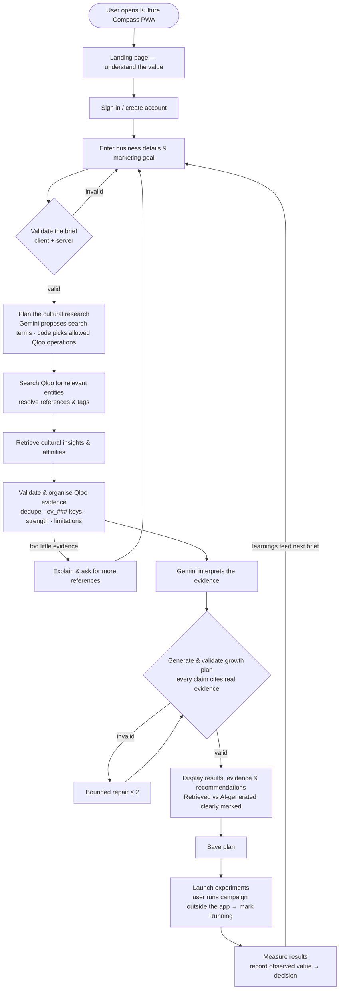
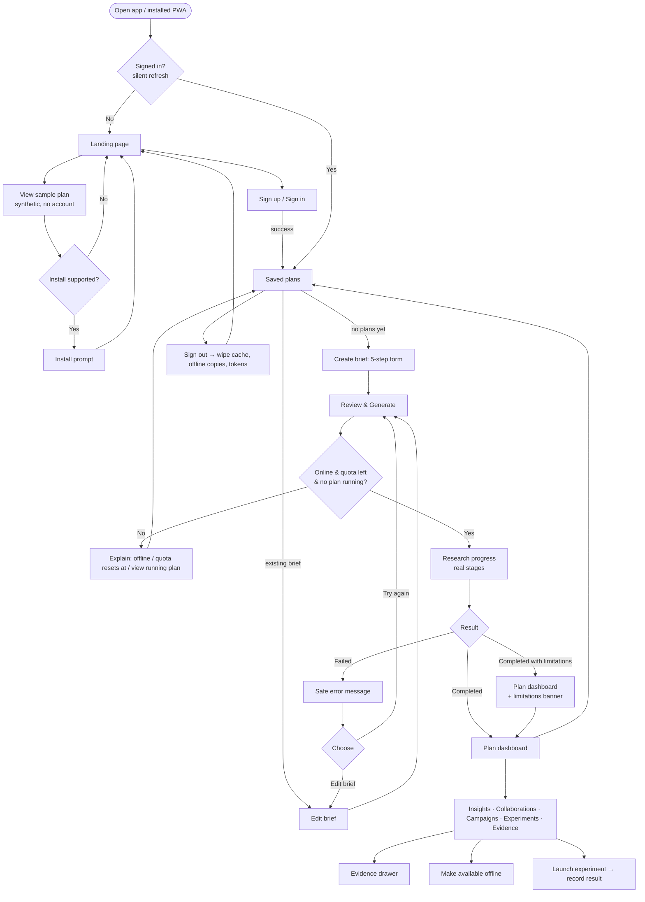
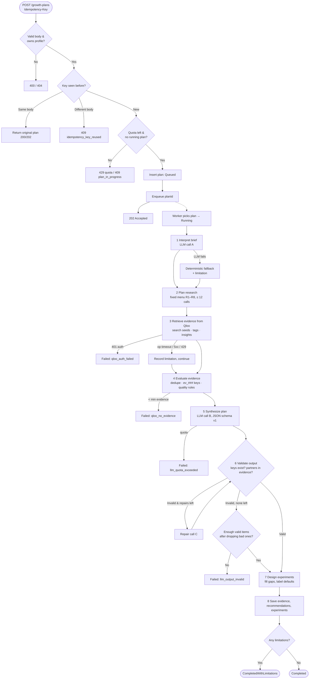
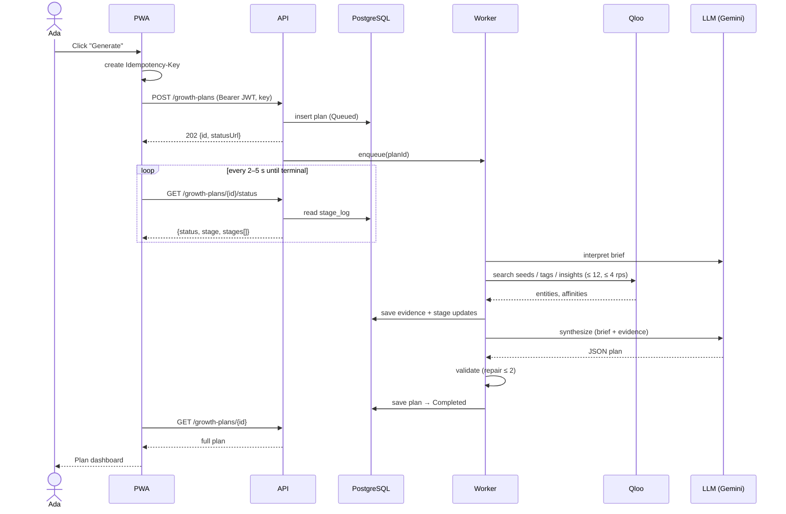
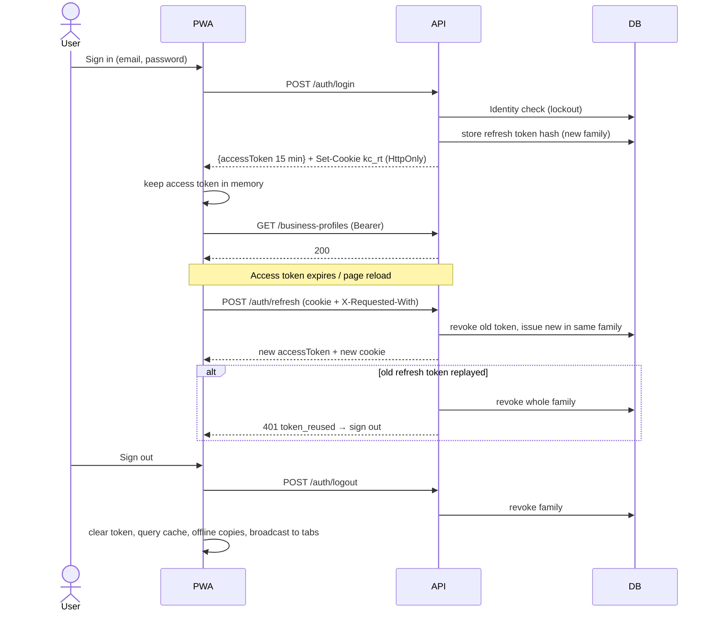
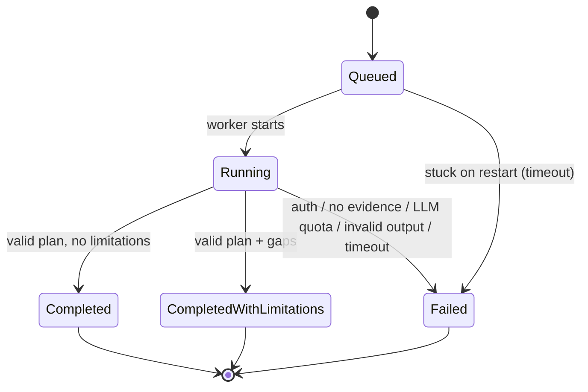
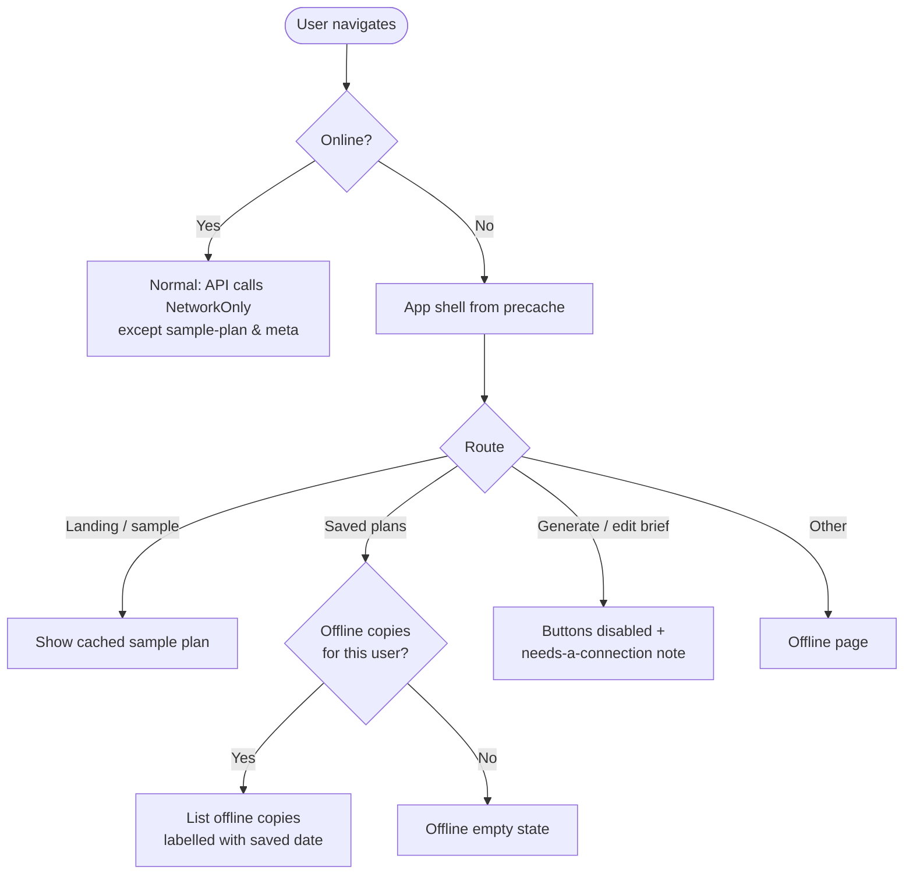

# 05 — User Stories & Flow Charts

Personas (see 00-product-brief §4): **Ada** — founder of a Lagos streetwear label (primary user) · **Tunde** — marketing
freelancer serving several SMEs · **Judge** — hackathon evaluator · **Dev** — the engineer operating the app.

Priority: **M** = Must (MVP), **S** = Should, **C** = Could (stretch). "Slice" = where it is built (BE-x / FE-x).

---
## 1. User stories

### Epic A — Discover & try
| ID | Story | Pri | Acceptance criteria | Slice |
|---|---|---|---|---|
| US-A1 | As **Ada**, I want a landing page that explains what Kulture Compass does in plain words, so that I can decide quickly whether it's for my brand. | M | Given I open `/`, I see the value proposition, the 3-step "how it works", an honest note that affinities ≠ guaranteed sales, and CTAs "Get started" and "See a sample plan". No fake testimonials or stats. | FE-5 |
| US-A2 | As a **Judge**, I want to view a sample plan without creating an account, so that I can evaluate the product in seconds. | M | Given I click "See a sample plan", `/sample` loads a plan labelled "Sample plan · synthetic data" with evidence chips, drawer, all tabs working. | BE-8, FE-5 |
| US-A3 | As **Ada**, I want to install the app on my phone, so that I can open my plans like a native app. | M | Given my browser supports install and I've viewed a plan, I see an install prompt; on iOS I see "Share → Add to Home Screen" instructions; once installed the app opens standalone. | FE-7 |

### Epic B — Account & session (JWT)
| ID | Story | Pri | Acceptance criteria | Slice |
|---|---|---|---|---|
| US-B1 | As **Ada**, I want to create an account with email and password, so that my briefs and plans are private to me. | M | Valid email + password (≥ 10 chars, 3 of 4 classes) → account created and I'm signed in; existing email → "An account with this email already exists"; password rules shown live. | BE-5, FE-1 |
| US-B2 | As **Ada**, I want to sign in and stay signed in across reloads, so that I don't re-enter my password every visit. | M | Correct credentials → `/app/plans`; reload → session restored silently via refresh cookie; wrong credentials → one generic error; 5 failures → locked 15 min message. | BE-5, FE-1 |
| US-B3 | As **Ada**, I want to sign out on a shared device and know nothing of mine is left behind, so that my brand strategy stays private. | M | Sign-out revokes the refresh token, clears memory token, query cache, offline copies and other open tabs; back button doesn't show private data. | BE-5, FE-1, FE-6 |
| US-B4 | As a **Judge**, I want a ready demo account, so that I can test generation without registering. | S | When `DEMO_USER_*` are configured (non-Production), the account exists at startup and is documented in the demo script. | BE-5 |

### Epic C — Business brief
| ID | Story | Pri | Acceptance criteria | Slice |
|---|---|---|---|---|
| US-C1 | As **Ada**, I want to describe my brand, products, market, goal and budget in a guided form, so that the research fits my business. | M | 5-step form; required: brand name, category, products (≥ 10 chars), objective; others optional; inline validation mirrors the server; "Save brief" creates the profile. | BE-5, FE-2 |
| US-C2 | As **Ada**, I want to add brands, artists, places or shows my customers love, so that the research starts from real cultural signals. | M | Up to 8 references each with a kind; helper text says they'll be looked up in Qloo and unmatched names will be listed, not guessed. | FE-2, BE-4 |
| US-C3 | As **Tunde**, I want to keep separate briefs for each client and edit them later, so that I can rerun research when things change. | M | Profiles list per user; edit uses concurrency check — if changed elsewhere I'm told to reload instead of overwriting. | BE-5, FE-2 |
| US-C4 | As **Ada**, I want to proceed with a partial brief, so that I'm not blocked by fields I can't answer. | M | Only required fields block; missing optional info becomes plan limitations/assumptions, not errors. | FE-2, BE-6 |

### Epic D — Generate a Cultural Growth Plan
| ID | Story | Pri | Acceptance criteria | Slice |
|---|---|---|---|---|
| US-D1 | As **Ada**, I want to generate a growth plan from my brief with one click, so that I get research I couldn't afford otherwise. | M | Generate → 202 → progress page; daily quota shown; one running plan per brief (else link to the running one). | BE-7, FE-4 |
| US-D2 | As **Ada**, I want to see real progress while research runs, so that I trust something meaningful is happening. | M | Stepper shows only backend stages with real counters (e.g. "4 of 9 Qloo requests complete"); no fake % bar; I can leave and come back. | BE-6/7, FE-4 |
| US-D3 | As **Ada**, I want a double-click or flaky network not to create duplicate plans or burn my quota, so that retrying is safe. | M | Same Idempotency-Key reused on manual retry returns the same plan; no auto-retry of generation; quota counted once. | BE-7, FE-4 |
| US-D4 | As **Ada**, I want a clear, human message if research fails, so that I know what to do next. | M | Failed plan shows a user-safe reason (e.g. "Add 1–3 reference brands or artists your customers love") with "Edit brief" and "Try again". | BE-6, FE-4 |
| US-D5 | As **Ada**, I want to know when the plan is incomplete, so that I don't over-trust thin data. | M | `CompletedWithLimitations` → amber banner + limitations panel listing coverage gaps (e.g. no reliable Lagos venue data). | BE-4/6, FE-5 |

### Epic E — Understand the plan
| ID | Story | Pri | Acceptance criteria | Slice |
|---|---|---|---|---|
| US-E1 | As **Ada**, I want cultural insights that show what the data says and, separately, why it matters for me, so that I can tell fact from interpretation. | M | Each insight shows a "Retrieved from Qloo" finding with evidence chips and an "AI-generated" why-it-matters block; assumptions and limitations listed. | BE-6, FE-5 |
| US-E2 | As **Ada**, I want collaboration ideas with real brands/artists found in the data, so that I can approach partners with a reason. | M | Every partner is an evidence-linked entity; shows connection, format, fit rationale, how to test; no contact details, follower counts or fake relationships. | BE-6, FE-5 |
| US-E3 | As **Ada**, I want 1–3 focused campaign concepts tied to the cultural insight, so that I know what to run next. | M | Each campaign: objective, hypothesis, insight with evidence, angle, execution steps, success metric, effort level, assumptions. | BE-6, FE-5 |
| US-E4 | As **Ada**, I want each campaign turned into a measurable experiment, so that I can learn what works with a small budget. | M | Hypothesis, segment, metric, period, threshold (labelled "Proposed default" if not mine), decision rule if success/if not. | BE-6, FE-5 |
| US-E5 | As **Tunde**, I want to inspect any piece of evidence, so that I can defend recommendations to my client. | M | Clicking a chip opens a drawer: entity, type, affinity/popularity (only if returned), tags, strength + reasons, source signal, retrieved time, "used in" links. | FE-5 |
| US-E6 | As **Ada**, I want names the AI mentioned but Qloo didn't return to be flagged, so that I'm not misled. | M | "AI suggestions not found in Qloo" box lists them; they can never be collaboration partners. | BE-6, FE-5 |
| US-E7 | As **Ada**, I want to be told clearly when I'm looking at mock or sample data, so that I never mistake it for real research. | M | Persistent banner when `isMock`/`isSample`. | BE-6, FE-5 |

### Epic F — Saved plans, offline & tracking
| ID | Story | Pri | Acceptance criteria | Slice |
|---|---|---|---|---|
| US-F1 | As **Ada**, I want all my plans listed with their status, so that I can revisit or compare them. | M | Paged list with brand, headline, status, date, counts; filter by brief/status; empty state with CTA. | BE-7, FE-6 |
| US-F2 | As **Ada**, I want to save a plan for offline reading, so that I can review it at a market stall with bad network. | M | "Make available offline" stores that plan on this device for this user only; offline, Saved Plans shows offline copies; removal option in account menu. | FE-6/7 |
| US-F3 | As **Ada**, I want the app to tell me honestly what doesn't work offline, so that I'm not confused. | M | Offline banner; Generate/Save disabled with explanation; nothing is queued to run later. | FE-7 |
| US-F4 | As **Ada**, I want to mark an experiment as launched and later record how it went, so that I close the loop from plan to measured result. | M | "Start experiment" sets Running with a start date; "Record result" captures observed value, notes and Concluded/Abandoned; the card compares the result with the success threshold text and shows the matching decision (if success / if not). Launching the campaign itself happens outside the app. | BE-8, FE-5 |

### Epic G — Evaluation (judges/dev)
| ID | Story | Pri | Acceptance criteria | Slice |
|---|---|---|---|---|
| US-G1 | As a **Judge**, I want to compare an LLM-only plan with a Qloo-grounded plan for the same brief, so that I can see what Qloo adds. | S | Side-by-side outputs + neutral metrics table (traceable vs unsupported entities, evidence coverage, numeric claims, specificity, brief coverage); no automatic "winner"; caveat shown. | BE-8, FE-8 |
| US-G2 | As **Dev**, I want evaluation hidden in public deployments when quota is tight, so that costs stay controlled. | S | Feature flag off → menu hidden and API returns `feature_disabled`. | BE-8, FE-8 |

### Epic H — Operations & trust (non-functional stories)
| ID | Story | Pri | Acceptance criteria | Slice |
|---|---|---|---|---|
| US-H1 | As **Dev**, I want the whole workflow to run in mock mode without keys, so that anyone can run and test it. | M | `QLOO_MODE=Mock LLM_PROVIDER=Mock docker compose up` → full flow works, every output labelled mock. | BE-3/6/10 |
| US-H2 | As **Dev**, I want API keys, tokens and passwords never exposed in the browser, logs or Git. | M | Redaction tests pass; secret scan in CI; no `VITE_*` secrets. | BE-9, FE-0 |
| US-H3 | As **Dev**, I want expensive calls rate-limited and bounded, so that one user can't exhaust Qloo/LLM quotas. | M | Per-user daily quota, per-minute limits, ≤ 12 Qloo calls/plan, ≤ 2 LLM repairs, overall timeout. | BE-4/7/9 |
| US-H4 | As **Dev**, I want health endpoints and structured logs with trace ids, so that I can diagnose failures quickly. | M | `/health`, `/health/ready`; logs include TraceId/PlanId, provider durations and failure category. | BE-1/9 |

---
## 2. Flow charts (Mermaid — renders on GitHub and in VS Code with a Mermaid preview extension; PNG renders in `flows/`)

### 2.0 Core product flow (canonical)

### 2.1 End-to-end user journey

### 2.2 Plan generation — backend pipeline

### 2.3 Generate & poll — sequence

### 2.4 Authentication (JWT + refresh cookie)

### 2.5 Plan status state machine

### 2.6 Offline / PWA behaviour

